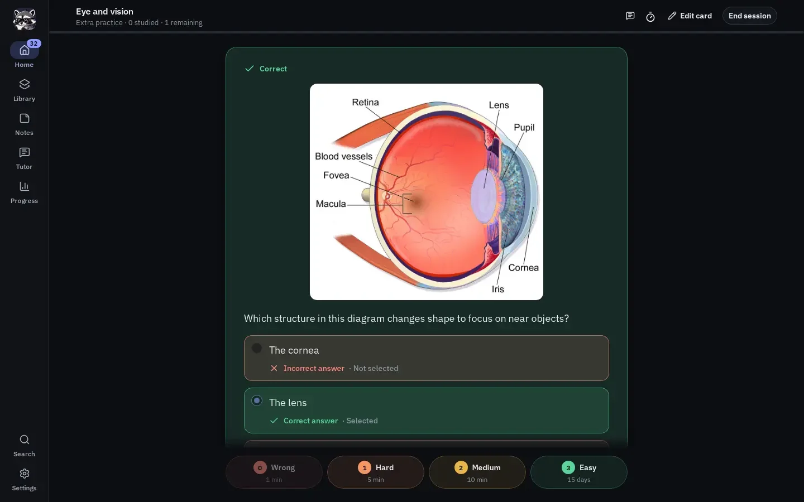
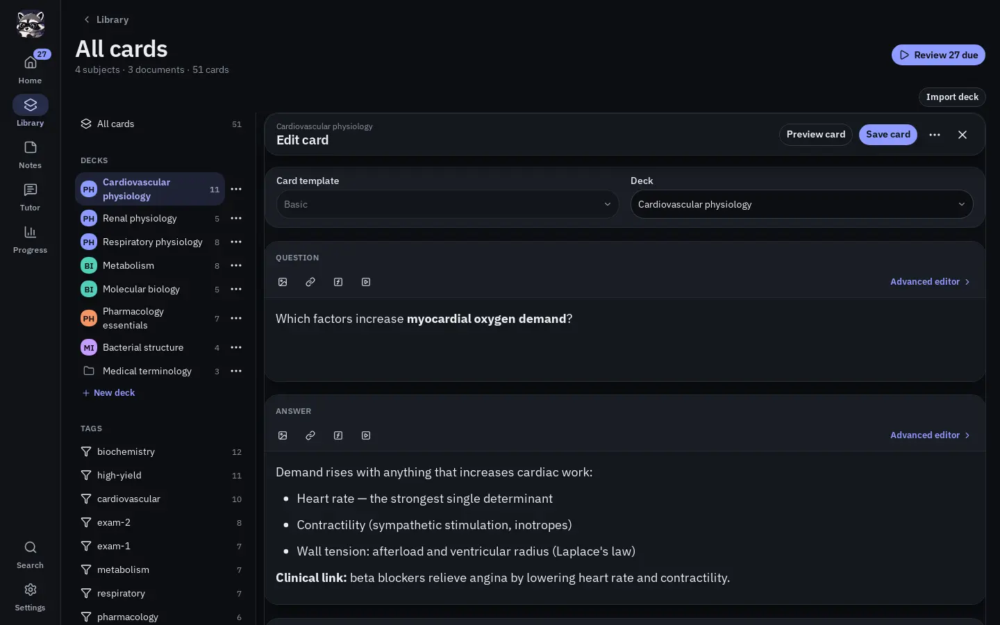
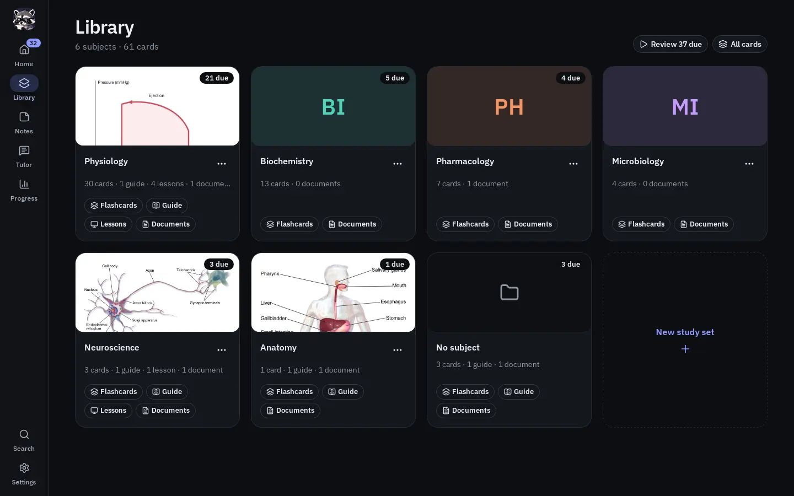
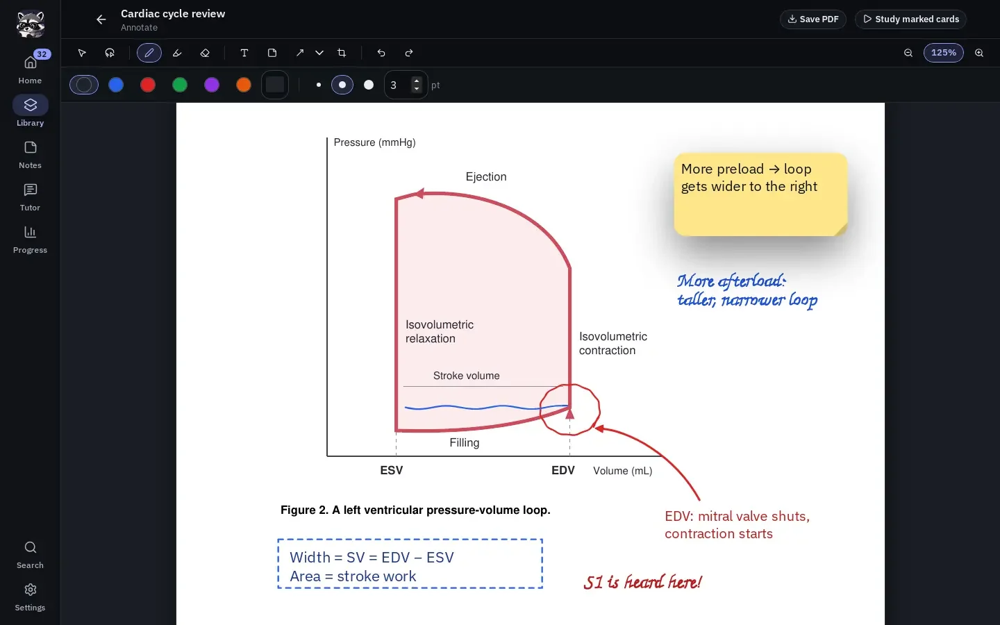
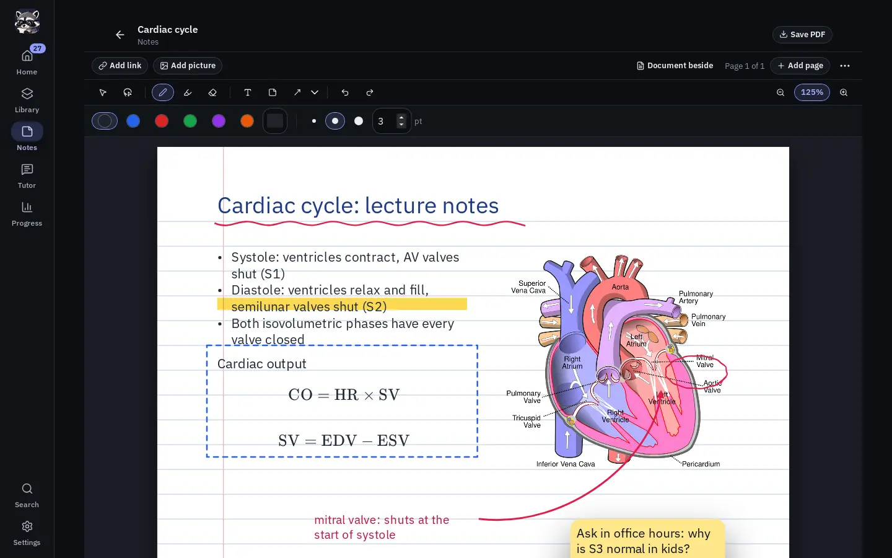
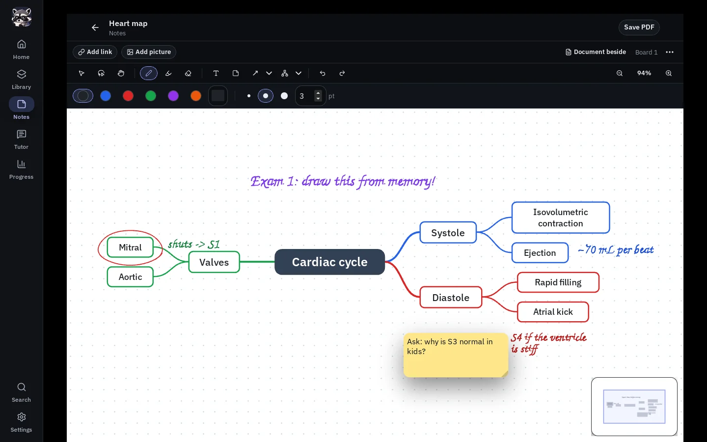
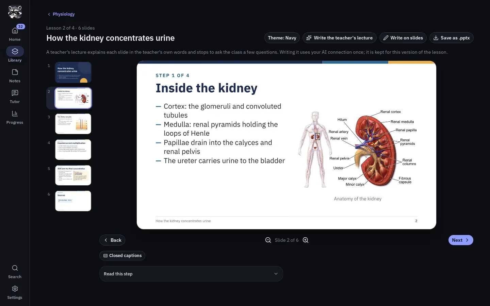

# ostudy


**ostudy is a free, open-source study app that keeps your library on your own device.** Write and review flashcards with spaced repetition, read and mark up your course documents, take handwritten notes and draw mind maps, and follow your progress, all without an account. When you want more, connect an AI service of your choice and ostudy turns your documents into flashcards, study guides, narrated lessons and podcasts, and gives you a tutor that knows your material.

[**Download ostudy 0.1.0 for Linux**](https://ostudy.io/install/) · [Release notes and files](https://github.com/jferments/ostudy/releases/tag/v0.1.0) · [Build for Android](docs/installation/android.md) · [Documentation](docs/README.md)


## What you can do with it

### Flashcards that schedule themselves

Write Basic, Reverse and Fill in the blank cards, or questions that ostudy checks for you: single best answer, select all that apply, true or false, matching, grouping, ordering and image occlusion. Cards hold formatted text, formulas, chemistry, images, audio and video. Practice rates each answer **Wrong**, **Hard**, **Medium** or **Easy**, shows the interval each rating would give, and schedules the card with [FSRS](https://github.com/open-spaced-repetition). Home shows what is due today and starts the review in one click.

<p align="center">
  
  
</p>

### Your courses, organized by subject

Library has a tile for every subject. A subject keeps one course together: its documents, flashcard decks, study guides, lessons and podcasts, each on its own tab. **New study set** starts a subject from your documents, from a short description of what you want to learn, or both, and makes the materials you tick.

<p align="center">
  
</p>

### Read, annotate and learn from documents

Add PDFs, Word and PowerPoint files, OpenDocument, EPUB, RTF, spreadsheets, CSV, or a set of screenshots and photos. ostudy keeps a copy and reads it on your device, with OCR for scanned pages. Write on PDF pages with a pen, highlighter, shapes, text and sticky notes, then make flashcards from what you marked and practice exactly those cards. Save a copy of the PDF with your marks drawn in.

<p align="center">
  
</p>

### Notes, boards and mind maps

**Notes** holds notebooks you write and draw in with the same tools: lined, grid or dotted pages, pictures, clips from your PDFs, and links that open a document page, a study guide, a deck or another note. Boards give you an endless canvas, and the mind map tool builds a tidy map as you type (boards and mind maps arrive in the release after 0.1.0). A notebook saves as an ordinary PDF.

<p align="center">
  
  
</p>

### With AI: study guides, lessons, podcasts and a tutor

With an AI service connected, ostudy can make from your documents:

- **Flashcards** sized to the key ideas on each page, in the card formats you allow.
- **Study guides** laid out as designed pages: key points with boxes and tables beside the text, the document's own figures, one Sources line per section, a one-page cram sheet, and PDF export. You can write on them like any page.
- **Lessons**, shown as lecture slides that a teacher talks through aloud, stopping now and then to ask you a question. Slides can be saved as a PowerPoint deck.
- **Podcasts**, where two hosts talk through a subject's lessons.

**Tutor** is a chat that answers from the model's knowledge and grounds its answers in your documents, decks and guides when you add them. It can quiz you with question cards, read a picture you paste, show a figure from your documents, read its answers aloud, take your questions by voice (turned into text on your device), and turn an answer into flashcards.

<p align="center">
  
</p>

### Tracks your learning progress

Progress is calculated from your own review history: how much you remembered, study time, streaks, card strength, the tags that need attention, what is coming up, and an activity calendar. 


## Your data, your AI, your choice

- **Local first.** Cards, documents, notes, schedules and review history live in a library on your device. Studying works offline, with no account, no telemetry and no AI. Until you set up an AI service, ostudy simply hides the features that need one.
- **Bring your own AI.** ostudy works with **OpenRouter** (one key covers text, voice, pictures and search), **Claude**, **DeepSeek**, or a **llama.cpp / Unsloth GGUF** server on your own computer or network. A guided setup walks you through the first one. Lessons can be read aloud for free on your device with Kokoro. ostudy never quietly moves a task from a local server to the cloud, and what you pay a provider is between you and them.
- **Bring your cards.** Import Anki `.apkg` decks, a Quizlet set's exported text, ostudy `.studydeck` files and generated `.ostudy.json` decks. Share a deck without your review history.
- **Keep it safe.** Back up the whole library to one `.ostudybackup` file and restore it without restarting. Sync chosen parts of your library directly between your own devices over the local network or a USB cable, with no cloud in between.
- **Comfortable to use.** Light, Dark, Console and Synthwave themes, adjustable fonts and sizes, reduced motion, keyboard shortcuts, and layouts for wide screens and phones.


## Install

ostudy 0.1.0 is out for Linux, and it runs on Android from source.

| Platform | How to get it |
| --- | --- |
| Linux (x86-64) | `.deb`, `.rpm`, Flatpak, AppImage or a portable folder from [ostudy.io/install](https://ostudy.io/install/) or the [GitHub release](https://github.com/jferments/ostudy/releases/tag/v0.1.0). They are built on Ubuntu 22.04, so they run on it and on newer distributions. |
| Android 9 or newer (64-bit ARM) | A signed download is on its way. Until then, [build it on Linux and install it over USB](docs/installation/android.md). |
| Windows, macOS, iOS | Not released yet. Windows and macOS can be built from source for development; see the [installation overview](docs/installation/README.md). |

To build from source on Ubuntu or Debian:

```bash
./scripts/setup-ubuntu.sh   # first time: system packages, toolchains and a first build
./run-app.sh                # start the build
```

After changing the source, run `./scripts/build.sh` and then `./run-app.sh` again. A source build is a development copy with its own library, kept apart from the installed app. The [Linux guide](docs/installation/linux.md) covers OCR for scanned PDFs, packages and troubleshooting.

ostudy is young and changing quickly. Back up your library before installing a newer build: a newer build upgrades the library when it first opens it, and an older build cannot open it afterwards.

## Learn more

New to ostudy? Start with **[Getting started](docs/user-guide/getting-started.md)**. Every guide is listed in the [documentation index](docs/README.md).

| To learn about | Read |
| --- | --- |
| Home, Library, your first subject, deck and practice | [Getting started](docs/user-guide/getting-started.md) |
| Writing, finding and editing cards in the Workbench | [Library Workbench and authoring](docs/user-guide/flashcards-workspace.md) |
| Subjects, decks, archiving and deleting | [Subjects and deck organization](docs/user-guide/flashcards-organization.md) |
| Practice, ratings, scheduling and the Progress page | [Practice, scheduling, and Progress](docs/user-guide/practice-and-analytics.md) |
| Adding documents, New study set, and what AI makes from them | [Documents and AI generation](docs/user-guide/documents-and-ai-generation.md) |
| Writing on PDF pages and making cards from your marks | [Annotating PDF pages](docs/user-guide/pdf-annotation.md) |
| Notebooks, boards and mind maps | [Notes](docs/user-guide/notes.md) |
| Reading, marking up and exporting study guides | [Study guides](docs/user-guide/study-guides.md) |
| Lectures, the teacher's questions, voices and podcasts | [Lessons and podcasts](docs/user-guide/lessons-and-podcasts.md) |
| Chatting with the Tutor, and what it keeps | [Tutor](docs/user-guide/tutor-memory-and-privacy.md) |
| Setting up an AI service and choosing models | [AI providers](docs/user-guide/ai-providers.md) |
| Bringing decks from Anki | [Anki import](docs/reference/anki-import.md) |
| Sharing decks, Quizlet import, backup and restore | [Backups, imports, and sharing](docs/user-guide/backups-imports-and-sharing.md) |
| Syncing your own devices | [Device synchronization](docs/user-guide/device-sync.md) |

For how ostudy is built, read the [architecture overview](docs/architecture/overview.md). The [roadmap](docs/roadmap.md) says what is being worked on next.

## Contribute

Bug reports, documentation fixes, tests and code are welcome. [CONTRIBUTING.md](CONTRIBUTING.md) explains how to report a useful issue and prepare a change; automated contributors start at [AGENTS.md](AGENTS.md).

ostudy is licensed under the [MIT License](LICENSE).

The diagrams in the screenshots are from Wikimedia Commons: the eye and kidney drawings by BruceBlaus (Blausen Medical), [CC BY 3.0](https://creativecommons.org/licenses/by/3.0/), and the heart by Wapcaplet, [CC BY-SA 3.0](https://creativecommons.org/licenses/by-sa/3.0/). The study material shown is demonstration data.
