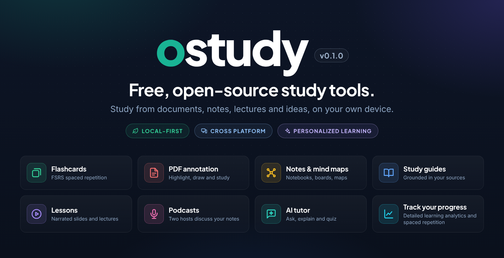

# ostudy



**ostudy** is a free, open-source study application that combines flexible flashcards, spaced repetition, learning analytics, and optional AI-assisted authoring. Your library lives on your own computer, core study features do not require an account, and AI is used only through a provider that you explicitly configure.

The project is being built for learners who want the convenience of modern AI study tools without giving a single subscription service permanent control over their notes, review history, or choice of model. You can connect ostudy to an existing local model server or to a supported cloud API. When you use a paid API, you pay that provider directly rather than buying a separate study-app subscription; for many light or moderate study workflows this can be substantially less expensive, although the actual cost depends on the model, document size, and usage.

ostudy is under active development. Linux is the currently qualified desktop path. Windows and macOS source-build support is being prepared for regular qualification, and Android and iOS are planned. See [Platform availability](#platform-availability) and the [roadmap](docs/roadmap.md) for the current status rather than assuming that every planned platform or AI feature has already shipped.

## Why ostudy

- **Free and open source.** The application can be inspected, modified, and built without paying for a proprietary study-platform subscription.
- **Local first.** Decks, cards, documents, schedules, review history, settings, and analytics remain in your local library.
- **Choice of AI.** Current builds support existing llama.cpp/Unsloth GGUF servers and DeepSeek. Ollama, OpenAI, Gemini, and Claude integrations are planned.
- **Local models and direct API access.** Use a free model running on hardware you control, or pay a supported model provider directly instead of adding another monthly study-app fee.
- **No forced cloud fallback.** A local provider is never silently replaced with a cloud provider. ostudy sends requests only to the profile selected for the task.
- **Portable data.** Share individual decks, import generated cards, and make complete local backups without depending on an online account.
- **Detailed learning feedback.** Spaced repetition, scheduling controls, search, tags, and analytics are part of the study system rather than separate paid add-ons.
- **Built for major platforms.** Linux is the current qualified target, with Windows, macOS, Android, and iOS included in the project’s cross-platform roadmap.

## Features

### Create and organize study material

- Create **Basic**, **Reverse**, and **Fill in the blank** flashcards with formatted text, lists, links, and images.
- Build reusable card templates for subjects that follow a consistent structure.
- Organize material with decks and tags, search the full library, and filter cards by schedule or study history.
- Add cards one at a time or in bulk, detect duplicates, and move or copy cards between decks.
- Import decks shared by other ostudy users or card files generated by another authoring tool.

### Learn with spaced repetition

- Use spaced repetition so difficult cards return sooner and well-known cards return later.
- Practice one deck or combine several decks into a study session.
- Rate each answer as **Wrong**, **Hard**, **Medium**, or **Easy** and preview when the card will return.
- Suspend, bury, reset, or manually reschedule cards, set daily limits, and identify material that needs more practice.
- Follow your progress with detailed analytics for study time, retention, confidence, workload, decks, tags, and recent sessions.

### Generate flashcards with AI

- Import a PDF into your personal document library and ask AI to create a new flashcard deck automatically.
- Use an existing local model server, a model running on another computer you control, or a supported cloud API.
- Stop a long-running generation job, retry a failed job, or generate additional cards from the same retained document.
- Edit or delete generated cards through the same ordinary deck tools used for manually created cards.

PDF processing is one of the newest parts of ostudy and is still being hardened. The [document-generation guide](docs/user-guide/documents-and-ai-generation.md) explains the current workflow and limitations. The lower-level extraction, rendering, OCR, and model design is documented separately in [AI and document processing](docs/architecture/ai-and-document-processing.md).

### Own, back up, and share your library

- Share a portable deck with a friend without including your personal review history.
- Import structured card files created by an LLM or another authoring tool.
- Create a complete backup of your local library and managed files.
- Keep AI credentials out of shared decks and backup files.

## Planned study tools

The document platform is intended to support more than flashcard generation. Planned work includes source-grounded study guides, practice tests and quizzes, interactive AI tutoring, user-controlled synchronization between devices, regularly qualified Windows and macOS releases, and native Android and iOS applications. These are roadmap items, not current feature claims. See the [project roadmap](docs/roadmap.md) for priorities and status.

## Platform availability

| Platform | Current status |
| --- | --- |
| Ubuntu/Debian Linux | Primary qualified development path; Linux release automation is present. |
| Other Linux distributions | May build from source, but package and native-dependency setup varies by distribution. |
| Windows | Source-build support is in progress and is not yet continuously qualified. |
| macOS | Source-build support is in progress and is not yet continuously qualified. |
| Android | Planned; no installable mobile application is currently provided. |
| iOS | Planned; no installable mobile application is currently provided. |

Detailed and platform-specific instructions live in the [installation guide](docs/installation/README.md).

## Build and run on Ubuntu or Debian

The repository currently provides a complete setup path for Ubuntu and Debian development systems. From the repository root:

```bash
./scripts/setup-ubuntu.sh
./run-app.sh
```

The setup script installs the required system packages, pinned development tools, JavaScript and Rust dependencies, and the PDF rendering runtime, then creates an initial standalone debug build. OCR support for scanned or damaged PDFs is an additional installation step described in the [Linux guide](docs/installation/linux.md). `run-app.sh` starts the existing build without rebuilding it.

After changing source code:

```bash
./scripts/build.sh
./run-app.sh
```

Before proposing a change:

```bash
./scripts/check-changed.sh  # quick iteration aid
./scripts/check-static.sh   # repository, type, link, and format contracts
./scripts/check-fast.sh     # frontend tests and Rust compile checking
./scripts/check.sh          # complete merge qualification
```

See [Linux installation](docs/installation/linux.md) for prerequisites and troubleshooting, and [Testing and CI](docs/development/testing-and-ci.md) for the purpose of each validation tier.

## Documentation

The [documentation index](docs/README.md) is the starting point for all detailed material. Major sections include:

- [Getting started](docs/user-guide/getting-started.md)
- [Backups, imports, and sharing](docs/user-guide/backups-imports-and-sharing.md)
- [AI providers](docs/user-guide/ai-providers.md)
- [Roadmap](docs/roadmap.md)
- [Installation](docs/installation/README.md)
- [Architecture](docs/architecture/overview.md)
- [Development guide](docs/development/guide.md)
- [Contributing and issue reports](CONTRIBUTING.md)

## Contributing

Bug reports, feature proposals, documentation improvements, tests, and code contributions are welcome. Read [CONTRIBUTING.md](CONTRIBUTING.md) before opening a change. It explains how to submit a useful issue, how the repository is organized, and which checks protect the current data and architecture contracts.

ostudy is licensed under the [MIT License](LICENSE).
