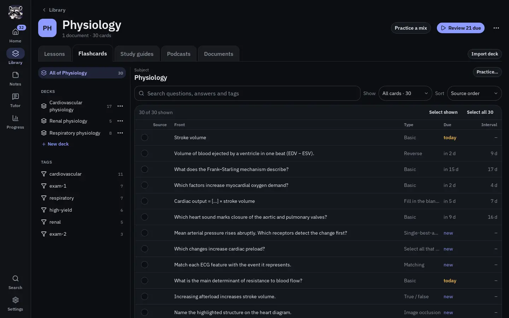
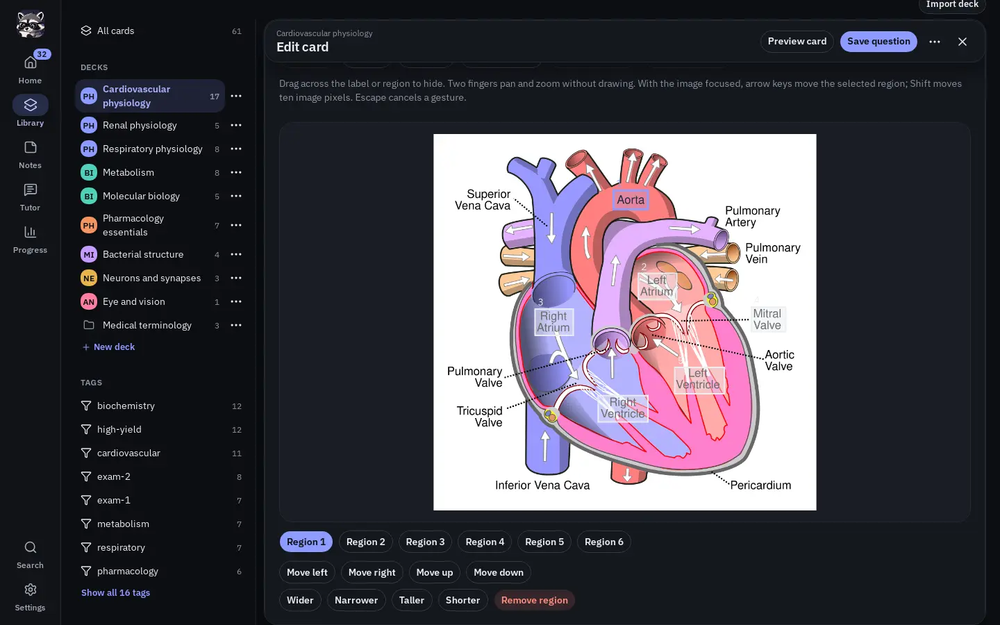
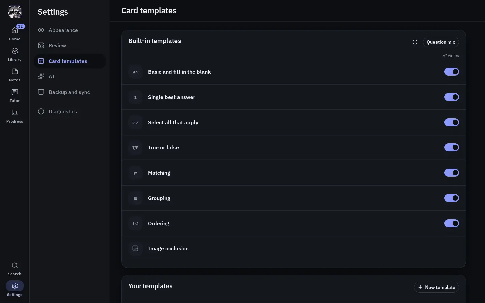

# Library Workbench, authoring, and search

Library's **Flashcards** tab opens the **Workbench**, one place to browse, search, edit, and organize your cards. It has three parts: the chosen subject's decks and tags on the left; the card list for whatever you chose in the middle; and the open card's editor on the right. The header's **Search** opens the Workbench on **All cards** with the search field focused. Reusable templates live in **Settings → Card templates**, not in Library. Deck import and export open from the Workbench's contextual actions; whole-library backup belongs in Settings → Backup and sync.

  

A subject's pages are tabs under its name: **Lessons**, **Flashcards** (the Workbench), **Study guides**, **Podcasts** and **Documents**; **All cards** on Library's page opens the Workbench on every card, without tabs. **Import deck** sits at the end of the tabs on the Flashcards page; on a phone it sits beside **New deck** under the decks, so the five tabs fit. The Workbench shows the subject you chose on Library's page; there is no second list of subjects inside it.

## The tree

The tree starts with all of the chosen subject's cards (**All of Physiology**, for example; **All cards** for every card and **Unsorted cards** under No subject), then has two sections:

- **Decks** lists the subject's decks in your order, each with its card count, and ends with **New deck**. Under All cards it lists every deck, each with its subject's badge. The subject's archived decks sit behind **Archived decks (N)**. See [Subjects and deck organization](flashcards-organization.md).
- **Tags** shows the eight tags the subject's cards use most; **Show all N tags** lists the rest. A tag chosen in a subject shows only that subject's cards with the tag.

Choosing the first entry, a deck, or a tag shows its cards in the list. A subject's documents are on its **Documents** tab.

## Screen sizes and going back

On a tablet or desktop window the tree and the card list sit side by side, and you can drag the divider between them. Opening a card shows its editor as a panel over the card list; close it with **×** and the list is exactly as you left it, scrolled to the same place with the same search, filter and selection. On a phone you see one page at a time: the tree, then the card list, then the editor. The list's back button returns to the tree.

Android Back steps back inside the Workbench before leaving Library: on a phone from the card list to the tree, and on wider screens from a deck or tag to all of the subject's cards. An open editor handles Back itself. Unsaved editor changes still ask before you discard them when you choose another place or another card.

The app keeps a device-local presentation checkpoint for useful destinations, including the deck open in the Workbench. It is not a copy of card content, credentials, or the entire screen state. A real practice session can resume over its logical launch destination. If the deck no longer exists, the Workbench falls back to **All cards**. This recovery does not resurrect deleted content.

## Start from an empty library

When the library has no active decks, **All cards** shows **No cards yet** with **New deck** and **Import deck**. On a phone the tree's **New deck** starts one. There are no empty folder tiles, selection controls, or collapse controls to work around. An archived-only library still lists its decks under **Archived decks (N)**.

A new deck goes under the subject you created it in, or under No subject when you start it from All cards or No subject. See [Subjects and deck organization](flashcards-organization.md) to file it later.

## The card list

The list shows the cards in the chosen place (All cards, a subject, a deck, or a tag) as dense rows. Each row shows the source unit when the card cites one (such as a slide or page number), the front, the card type, when it is due (**today**, **in 3 d**, **new**, or **suspended**), and its interval. On a phone each row shows the front with the type, source, and due date below it. More rows load as you scroll.

Above the list:

- The search box finds questions, answers, and tags within the current place.
- **Show** narrows the list to **All cards**, **Due today**, **New**, **Often missed**, or **Suspended**, with each count beside its name.
- **Sort** offers **Source order**, **Due first**, **Recently edited**, and **Recently studied**, plus **Best match** while you are searching. A deck or subject opens in source order.

Results describe actual study presentations: a forward and reverse card can appear separately, while a multi-blank cloze note appears once. An image-occlusion note can show several separately scheduled question presentations. Rows show compact question text; open a card to inspect its full rich content rather than treating truncation as missing data.

## Select cards and act on them

Use a row's checkbox to select it. Shift-click another checkbox to select the range between them. **Select shown** selects the loaded rows, and **Select all N** selects every card that matches the current list, including rows not loaded yet.

A selection opens a toolbar with **Move…**, **Tag…**, and **Suspend**. Its overflow menu adds **Practice…**, **Remove tags…**, **Resume**, **Bury until tomorrow**, **Unbury**, **Reschedule…**, **Reset schedules…**, and **Delete cards…**. Narrower screens move more of these into the overflow. **Deselect all** clears the selection. Moving, tagging, and deleting act on notes, so they account for presentations that share one source note. Review the scope and confirmation before acting.

**Practice…** opens **Practice these cards**: **Start practice** studies exactly the selected cards, and **Save as new deck** copies them into a new deck. Ending that practice returns to Library rather than a separate standing Practice tab. Schedule actions such as suspend, bury, reset, and reschedule alter availability or current schedules; they do not invent review events. [Practice, scheduling, and Progress](practice-and-analytics.md) explains those differences.

A tag on an answer in Progress's review log opens the Workbench on that tag's cards. A tag that has since been deleted still shows its old name but is no longer a link.

## Open and manage a deck

Choose a deck in the tree to list its cards. The header names the deck and its subject and offers **Practice**, **New card**, and the deck's actions menu. Practice is unavailable for a deck with no cards. The menu offers:

- **Bulk add…** for several plain-text cards at once.
- **Practice with options…**, which opens **Practice selected decks**: choose **Due** or **Extra** cards, optionally narrow by tags, and choose whether to shuffle.
- **Rename…**, **Move to subject…**, and **Merge into…**.
- **Export…** to save the deck as a portable file.
- **Archive** and **Delete deck**.

The same actions, plus **Move up** and **Move down**, are in the menu beside the deck in the tree. All of a subject's cards offers **Practice…**, which opens the same practice options for the subject's decks, and **New deck**.

**Merge into…** moves the deck's cards into another active deck while preserving card and note identities, schedules, review history, tags, media, and source provenance. The emptied source deck is archived afterward. Existing destination cards are not deduplicated just because their wording looks similar.

An archived deck is still readable, but practice and new cards are unavailable until you choose **Restore** from its menu. Archiving and deletion are different: archive retains recoverable material and its history; finalized deletion removes the data and analytics owned by the deleted material. **Delete deck** asks for confirmation and then offers **Undo**. Use it promptly; it is a bounded recovery window, not a permanent trash archive.

**Export…** saves one deck as a portable file. Opening the operating system's share sheet does not prove the receiving application completed the transfer. See [Backups and sharing](backups-imports-and-sharing.md).

## Add or edit cards

In a deck, **New card** opens the full rich editor for that deck. Choose a row to open that card in the editor. The editor's top bar keeps **Preview card**, **Save card** and **×** (close) in reach while you scroll; its **…** menu holds **Move / copy**, **Suspend** (or **Resume**) and **Reset schedule…** for that one card. Below the fields, the **Schedule** panel shows when it is **Due** and, once studied, its **Interval**, **Stability**, **Difficulty**, **Reviews**, and **Lapses**. **Bulk add…** in the deck's menu opens multi-row plain-text entry with the deck already fixed.

  
  

Basic questions and answers support the editor's allowed formatting, lists, links, managed images, and audio or video. Formatting shortcuts are an authoring convenience; the app stores a validated structured document, not arbitrary executable HTML. Images become managed library assets rather than references to arbitrary local paths or remote image URLs.

Use the editor's **Insert or edit formula** button for mathematical notation. The formula dialog includes graphical **Structures**, **Symbols**, **Relations**, **Greek**, and **Calculus** controls plus MathLive's full mathematical keyboard. Selecting existing math before choosing Fraction, Power, Root, or a grouping structure wraps that selection rather than requiring LaTeX or adding unwanted parentheses. See [Enter and edit mathematical formulas](formula-entry.md) for the graphical workflow and keyboard-shortcut reference.

A **note** is the shared editable source. A **card** is a presentation you study. A Basic note normally creates one forward presentation. Enabling Reverse creates an independently scheduled reverse presentation of the same source. Editing shared wording or tags therefore affects both directions, while the two cards retain independent review histories and schedules.

A **Fill in the blank** note marks text to hide. One-at-a-time mode selects a blank group for that review; all-together mode hides all groups. It still has one stable scheduled card rather than a separate schedule for every blank. Changing blanks or switching presentation mode does not imply a fresh learning history.

The same **Template** selector also opens purpose-built interactive editors for **Single best answer**, **Select all that apply**, **True/false**, **Matching**, **Grouping**, **Ordering**, and **Image occlusion**. These are native question kinds rather than Basic cards with special markup. Rich prompts/options/rationales reuse the ordinary editor and managed assets. Optional explanations stay collapsed until you choose to add one. **Preview card** uses the same presentation components as Practice; objective answers can be checked there with native feedback without recording a learner attempt or changing a schedule.

Single-best-answer requires exactly one correct option; select-all stores the exact correct set, including a deliberate empty set; true/false keeps unanswered distinct from false. Matching requires a one-to-one pairing, grouping assigns each item to one category, and ordering stores one explicit total order. Matching/grouping/ordering support drag interaction plus non-drag controls so dragging is not required to author or study them.

For **Image occlusion**, choose an image and draw rectangles over the labels or regions to hide. Each rectangle becomes its own study card automatically; no question or answer text is required, and revealing shows the uncovered image. **Group new rectangles with the selected card** makes several regions recall together on one card, and the question-side setting chooses between **Hide one region** and **Hide all regions**. One image supports up to 64 study cards. **Optional question details** adds a custom prompt, answer notes, or an explanation, or another question that reuses existing regions; each question keeps its own schedule. During practice the hidden regions are masked before the image is shown. Making cards from a document does not create image masks.

The normal editor reports duplicate candidates and requires deliberate override for an exact duplicate. Bulk entry, template generation, and generated JSON import skip exact duplicates according to their native validation rules. Image-only content is not declared duplicate solely because its searchable text is empty.

## Preview without leaving the editor

**Preview card** opens a full-width study presentation instead of a side panel. **Close preview** stays at the top while you scroll. Close it, press Escape when no dialog is open, or use Android Back to return to the same unsaved editor. Closing a preview does not save or discard the draft. Save shortcuts are inactive while preview is open.

Basic previews share Practice's rich-content surface, flip/motion setting, and media presentation. When Reverse is enabled, choose Forward or Reverse in the preview. Fill-in-the-blank preview uses the native Practice renderer and lets you inspect each authored blank group (or the all-together presentation) without creating another scheduled card. Reusable templates show each generated rule in the same full workspace.

Objective boards use native draft validation and **Check answer** feedback without creating an attempt or review. Image occlusion uses its managed masked-image renderer and lets you choose among authored target questions. Preview interactions do not record reviews, analytics, or schedules and do not call an AI provider. [Editor-preview ownership and tests](../development/editor-preview.md) describes the shared/native boundaries.

## Practice behavior for interactive questions

Objective interactive questions use **answer → Check answer → feedback → difficulty/continue**. Matching, grouping and ordering do not auto-submit when the last tile moves, and item moves do not leak correctness before Check. Correctness is calculated locally from the captured immutable question instance.

A single compound board produces one scheduling review. After an incorrect or incomplete answer only **Wrong** is available; after a correct one choose **Hard**, **Medium**, or **Easy**. A retry after feedback is practice only and does not replace the first attempt or add another successful review. Image occlusion is reveal-and-self-rate rather than pretending a free-form answer can be objectively graded.

Opening Tutor does not automatically mark the attempt assisted. Assistance is recorded only when usable help is actually exposed, and a late/failed/cancelled hint cannot rewrite a first result. Captured question revisions and answer keys remain frozen for the active attempt even if the editable note changes later.

## Drafts and saving

Recoverable drafts protect unfinished authoring. They are distinct from saved study content: an autosaved draft does not mean its cards have been committed to the deck. Draft revision checks prevent an older edit from silently overwriting a newer one. Discard and commit are separate operations, and draft-owned staged images follow that lifecycle.

Saving may succeed even when a following list refresh fails. Read an informational reconciliation message before retrying; repeating an already committed action can be different from refreshing the display. The native operation identity and UI guards protect supported retries, but they do not make every newly initiated action interchangeable.

## Reusable templates

Open **Settings → Card templates** to create, edit, preview, or remove reusable structures. Templates contain named fields and safe question/answer layout rules. They do not execute JavaScript, HTML, SQL, or arbitrary expressions.

  

A template is useful for repeating structures such as term/definition, mechanism/effect, or a comparison. Preview and generation use the same validated rendering path. Generated outputs become ordinary independent notes/cards with fresh schedules; later template edits or deletion do not retroactively change those cards.

The Settings template tab is a full normal workspace. Once opened it can retain its editor state while another Settings tab is selected, and unsaved changes remain protected when leaving the area.

## Importing content

**Import deck** beside Library's tabs (beside **New deck** on a phone, or in an empty library or subject) accepts portable `.studydeck`, compatible Anki `.apkg`, and compatible generated `.ostudy.json` input. There is no generated-import approval/preview queue. JSON is validated as a whole before the transaction; invalid content leaves the library unchanged and produces a useful error path. Imported study content receives local schedules rather than another learner's history.

Current `.studydeck` packages preserve native interactive question definitions and managed question assets while excluding the sender's schedules/practice history. The Workbench opens the new deck, which starts under No subject until you file it. Subject membership and the sender's personal learning history are not part of the portable deck. Whole-library recovery requires `.ostudybackup`, not an individual deck export.
