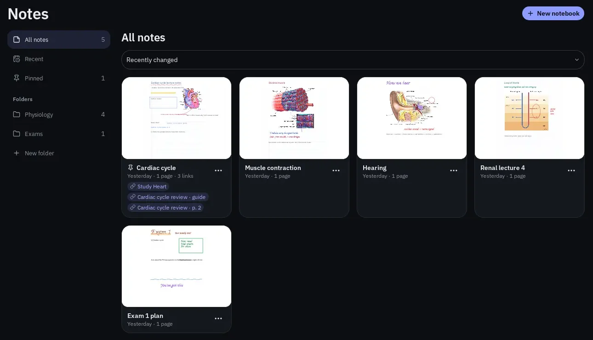
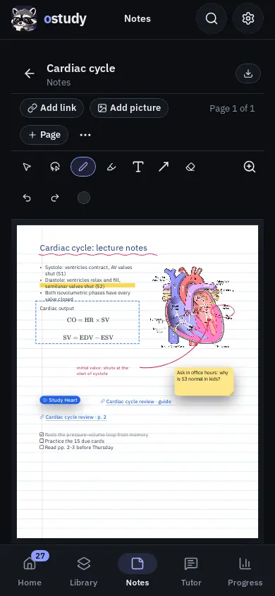

# Notes

A notebook is pages of paper, and boards, you write and draw on with the same tools as [Annotating PDF pages](pdf-annotation.md): pen, highlighter, text, sticky notes, lines, arrows, curves, boxes, ellipses, the eraser, Select and Lasso (with groups), with the same keys, colors and sizes. A note can also be a link to a page of a document, a study guide, a deck or another page of notes, and a page can hold pictures. Notebooks are saved in your library as you write.

## Find and make notebooks

Open **Notes** in the main navigation. Beside your notebooks is a list of places: **All notes**, **Recent** (the notebooks you changed last), **Pinned**, and your folders, with **New folder** under them; on a phone, a **Show** menu and a **New folder** button take its place. Each notebook is a tile with a small picture of its first page, when you last changed it, how many pages, boards and links it has, and the names of its first few links. Choose a notebook's picture to open it, and use **Sort notes** to list them by when they changed or by name.

  

A notebook's **…** menu has **Pin** (or **Unpin**), **Rename**, **Move to folder**, **Move to subject** and **Delete notebook**; deleting removes every page and cannot be undone. Folders are your own way to arrange notes and can hold other folders, four deep. An open folder shows the folders inside it as tiles, and its **…** menu has **New folder inside**, **Rename folder** and **Delete folder**. Deleting a folder deletes the folders inside it but keeps their notebooks, which go back to **All notes**. A notebook made while a folder is open goes in that folder. Folders are kept on this device: [device sync](device-sync.md) does not carry them.

**New notebook** asks for a name, the subject, what it **Starts with** (**Pages** or a **Board**), the paper (**Blank**, **Lined**, **Grid** or **Dots**) and, for pages, the page size: **Letter**, **A4**, or **Wide**, a landscape page twice as wide as Letter with room for mind maps and diagrams. A board has no ruled lines, so it offers Blank, Grid and Dots.

## Write and draw

The pages scroll in one column, and the toolbar, keys and zoom work as they do on a PDF; see [Tools](pdf-annotation.md#tools). The highlighter has no text to snap to on paper, so it always draws a free stroke. **Back to notes** returns to the list, and so does Android Back once nothing is open or selected. The header shows **Saving…** and **Saved**; if a save fails it shows **Not saved** with **Retry**, and leaving asks before discarding anything unsaved.

  
  

The bar above the toolbar shows which page is in view. **Add page** adds a page after it, with the notebook's paper and size. Its **…** menu moves the page earlier or later, or deletes it; a page with marks on it asks first, and a notebook keeps at least one page. Adding, moving or deleting a page saves your marks first and starts undo afresh.

## Boards

A board is one large sheet, about ten screens across at full size, for mind maps, diagrams and anything that outgrows a page. It opens at its middle, or fitted to what is on it, and zooms out until all of it fits the window. A notebook can hold pages and any number of boards: **Add board** in the page's **…** menu adds one, and when a notebook has boards the place shown in the bar (**Page 2 of 5**, or **Board 1**) is a menu that goes to the pages or to each board. A board's **…** menu adds a page or another board, or deletes the board.

On a board, the **Hand** tool drags the view, and holding **Space** picks it until you let go; two fingers, the middle mouse button and the scroll wheel pan as they do on pages. **Fit all** (**Ctrl+0**) fits everything on the board in the window. On a wide screen an overview in the corner shows the board's marks and the part in view; press or drag on it to move there. Links, pictures and clips added on a board go in the middle of the view.

Text notes can hold bulleted and numbered lists, checklists and formulas, as described in [Text notes](pdf-annotation.md#text-notes). A formula on its own in a note is a movable formula: drag the note to place it.

## Mind maps

The **Mind map** tool (**M**) starts a map on any notebook page or board: tap empty paper and type the central idea. With a topic selected or being typed, **Tab** adds a branch to it and **Enter** adds the next topic beside it (**Shift+Enter** starts a new line instead). The map keeps itself tidy: branches spread to both sides of the central topic, and each topic is as wide as its words. The Mind map tool otherwise works like Select, so it picks up and drags topics and other marks.

  

The arrow beside the **Mind map** button opens the map's actions: **Start a new map**, **Add a branch**, **Add the next topic**, **Move up a level**, **Fold branches** (and **Show branches**, which the folded topic's count also tells you about), the map's layout (both sides, to the right, or downward like an outline turned on its side), **Put this topic back in place**, **Tidy the map** and **Copy the map as a list**, which copies it as an indented list. Actions for a topic work on the selected one.

Right-click a topic (or press and hold it on a touch screen) for its own menu: **Edit topic**, the same actions, **Connect to another topic…**, **Detach as a free topic**, its **Colour** and **Text size**, the map's layout, **Add link…** and **Delete topic**.

- Drag a topic onto another topic to make it that topic's branch; its own branches come with it. Drag it anywhere else and it stays where you let it go, with its branches, and takes its place among its neighbours (or moves to the other side of the central topic); branches in its way move aside so nothing overlaps. **Put this topic back in place** returns one topic to the map's own layout, and **Tidy the map** returns them all. Dragging the central topic moves the whole map.
- The arrow keys go from topic to topic as the map is drawn, **Shift+Tab** moves a topic up a level, **F2** types in it and **/** folds or shows its branches.
- Deleting a topic deletes its branches with it; **Undo** brings them back.
- A topic takes the color and text size you choose like any text note. A new color is passed to the topic's branches that had its old color, so a branch keeps one color.
- **Add link** (**K**) with a topic selected turns the topic into a link with its words as the label.
- Paste an outline (Markdown bullets, numbered lines, headings, or lines indented with spaces or tabs) onto a page or board to make a map of it in the middle of the view. An outline with one top line makes that line the central topic; one with several top lines branches them from a new central topic, which opens for you to name.

### Webs of ideas

A map does not have to be a tree. Ideas that relate across branches, or in a loop, can be linked, and a map can start without a central topic at all.

- **Connect to another topic…** in a topic's menu, then click the topic (or box, ellipse or note) to link it to. The link is a curved, dashed arrow that stays attached at both ends, like any attached line. **Esc** or **Cancel** stops choosing.
- Right-click a line for its menu: **Add label…** writes a few words on it, such as *causes* or *is part of*, at its middle; **Edit label…**, **Remove label**, its **Colour** and **Delete line** are there too. Any attached line on a page or board can be labelled.
- A free topic is a topic of its own, drawn like a branch rather than a central topic. **Shift+click** with the Mind map tool, or **Add a free topic** in the map's actions, starts one; a web can be free topics and their links alone. Free topics take turns through the branch colors.
- **Detach as a free topic** makes a branch, with its own branches, a map of its own beside the others. Dragging a free topic onto a topic of another map makes it that topic's branch again.
- **Show as a free topic** and **Show as a central topic** change how a map's first topic is drawn.

## Lines that stay attached

On a notebook page or board, a line, arrow or curve drawn from one box, ellipse, text note, sticky note or mind-map topic to another stays attached to both. Its ends sit just outside each mark's edge and follow the marks wherever they go, so a concept map or flow chart stays connected as you rearrange it. A line drawn inside one mark, or from empty paper, stays where you drew it, and pictures are pointed at rather than attached to.

- Drag one end of a selected line onto another mark to attach it there, or onto empty paper to let it go. Moving the line on its own lets go of any end that leaves its mark; moving it together with a mark it is attached to keeps hold of both.
- Deleting a mark lets go of the lines attached to it; they stay where they were. **Undo** puts the mark and its lines back together.
- A line attached to a topic that is folded away is hidden with the topic.

Save PDF draws each map as it is shown: its topics in their boxes, the curved branches between them, the labels on lines, and nothing that is folded away.

## A document beside your notes

On a wide screen, **Document beside** opens a PDF from your library next to the notebook, so you can read and write at once. The document has every annotation tool, and its marks are saved with the document as you work; the notebook keeps its own tools on the other side. While a document is open beside the notes, a link to a document page opens there instead of over the notebook. **Change document** picks another, and **Close document** closes it. Leaving the notebook saves both. On a phone, a document page link opens over the notebook instead.

## Pictures

**Add picture** asks for an image file (PNG, JPEG, GIF or WebP, up to 25 MB) and puts it near the top of the page in view, selected, at its own size or smaller so it fits within the page's margins. Drag it to move it; drag a corner to resize it, keeping its shape, or hold **Shift** to stretch it. Pictures group, undo and delete like any other mark. The image is kept in your library for as long as a picture uses it, and library backups include it. Pictures go on notebook pages only, not on PDF pages.

A picture can also come from a PDF: **Clip to notes** in the PDF annotator copies part of a page into a notebook, and the clip keeps a way back to its page. Select it to see **From Lecture 7 · p. 4**, which opens that page over the notebook, or beside it when a document is open there. See [Clips](pdf-annotation.md#clips).

## Links

**Add link** (or **K**) opens **Add a link**. Choose what it opens:

- **Document page**: a PDF in your library and a page of it.
- **Study guide**: a document's study guide.
- **Flashcards**: a deck.
- **Notes page**: a page of this or another notebook.

The label starts as the target's name, such as "Lecture 7 · p. 9" or "Study Heart", and you can change it. **Show as** draws the link as underlined words, or as a **Button**; a deck's link starts as a button. The link is placed near the top of the page in view, selected, so you can drag it where it belongs.

Select a link to see **Open link** and **Edit link**; tapping a selected link again also opens it. A document page opens over the notebook at that page, with every annotation tool; a study guide opens in **Study guides**; a deck's link starts Practice on its cards; a notes page scrolls to that page, or opens the other notebook there. Your notes are saved before you leave.

A link whose target has been deleted (a document, a page, a study guide, a deck or a page of notes) stays on the page, struck through, and opens nothing.

## Save a notebook as a PDF

**Save PDF** in the notebook's header (a download button on a phone) saves the notebook as an ordinary PDF that any reader can open, after saving anything still pending, and asks where to put it. Each page keeps its size and paper, and its marks are drawn as they are on screen, the way [Save PDF](pdf-annotation.md#save-a-copy-with-your-annotations) draws a document's annotations: typed text uses IBM Plex Sans, and each sticky note is also a PDF note holding its whole text. Pictures are embedded at the size you gave them. A link to a page of the same notebook becomes a PDF link to that page; links to a document, a study guide, a deck or another notebook stay on the page as their labels, since the reader of the file has none of those. A picture whose image cannot be read is left out, and the message after saving says so.

In a notebook with boards, **Save PDF** is a menu. **Each board on one page** puts each board on a page of its own, cut to its marks with a small margin. **Boards across Letter pages** (or **A4 pages**) splits each board's marks across printable pages, in rows from the top left. An empty board is saved as one blank page.

## Where notes are kept

Notebooks live in your library and are part of every [library backup](backups-imports-and-sharing.md). [Device sync](device-sync.md) sends them, with their pictures, when **Notes** is selected; they are not part of a shared deck. Deleting a subject moves its notebooks to **No subject**. A build of oStudy from before clips opens a library that has them, but leaves the clipped pictures out until a newer build opens it again; clips need no library upgrade.
