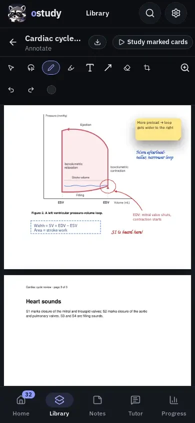

# Annotating PDF pages

The annotator lets you write, highlight, draw arrows and boxes, and type notes on the pages of a PDF in your library. The PDF itself is never changed: annotations are saved in your library as you work, page by page, and drawn over the page images made when the PDF was imported.

  
  

## Open a document

Open a subject's **Documents** tab and choose **Annotate** from a PDF's **…** menu. **Annotate** appears once the import has drawn the document's pages and the document is not being processed; other document formats cannot be annotated yet.

The pages scroll in one column. **Back to documents** returns to the list, and so do Escape (when nothing is selected) and Android Back. The header shows **Saving…** and **Saved** as you work. If a save fails it shows **Not saved** with **Retry**, and leaving asks before discarding anything unsaved.

### From a card's source

A card made from a PDF names its source pages. In the card editor its **Source** panel has **Open page N**, and in practice the bar above the card shows **Source, page N** once the answer is showing (on a phone it is in **Card actions**). Either opens the PDF over the card at that page, outlined for a moment, with every annotation tool, so you can mark the passage while you read it again. A card you made from a mark opens at that mark instead, with the mark selected; if you have since erased the mark, it opens at the mark's page. Closing saves your marks and returns to the card; in practice the time spent reading is not counted as the card's answer time.

A source opens only while its PDF is in your library. Once the document is deleted, or for cards from a shared deck (`.studydeck` files never carry the document or its citations), the source stays plain text.

## Tools

The toolbar groups the tools the way drawing and PDF apps do: **Select** and **Lasso**; **Pen**, **Highlighter** and **Eraser**; then what adds something to the page, **Text**, **Sticky note** and one shape button. The shape button draws the shape you used last, and the arrow beside it lists **Line**, **Arrow**, **Curve**, **Box** and **Ellipse**. **Undo** and **Redo** follow, and zoom sits at the right. Hovering over a tool shows its name and key.

| Tool | Key | What it does |
| --- | --- | --- |
| Select | V | Tap an annotation to select it, drag it to move it, and drag its handles to reshape it. A box or an ellipse can be picked up anywhere inside it. With a mouse or pen, dragging across empty page draws a rectangle that selects every annotation whose middle it takes; drag any of them (or use the arrow keys) to move them together, press **Delete** to remove them, or tap one to select just that one |
| Lasso | Q | Draw a loop around annotations on a page to select them together, then drag any of them (or use the arrow keys) to move them all, or press **Delete** to remove them. **Group** (Ctrl+G) keeps them together: after that, selecting or dragging any one of them takes the whole group, until **Ungroup** (Ctrl+Shift+G). Each move, delete, group or ungroup is one step to undo |
| Pen | P | Handwriting and drawing; a pen with pressure draws thicker when pressed harder |
| Highlighter | H | Drag across the PDF's text to mark whole lines of it; anywhere else, a wide, see-through stroke that keeps the text under it readable |
| Text | T | Tap where a note should go and type |
| Sticky note | S | Tap to place a small note that holds longer text and shows its first lines on the page |
| Line, Arrow, Box, Ellipse | L, A, R, O | Drag from one corner or end to the other. Hold Shift for a square, a circle, or a line at a multiple of 45 degrees |
| Curve | C | Drag from one end to the other to draw a gentle arc, then select it and drag its two square control points to bend it. Its arrowheads can be none, one or both |
| Eraser | E | Drag across annotations to remove each one it touches. Choose **Erase part of a stroke** beside it to take away only the part of a pen or highlighter stroke you drag across, leaving the rest as separate strokes (text highlights, shapes and notes are still erased whole); **Erase whole annotations** goes back. A stylus's eraser end, if it has one, erases with any tool, in the chosen way |
| Clip to notes | X | Drag a rectangle across part of a page, such as a diagram, and choose a notebook (or name a new one, filed in the document's subject). The part is drawn again from the PDF, sharply, and placed as a picture below what is already on the notebook's last page, or on a new page when there is no room. See [Clips](#clips) |

The strip under the tools shows only what the active tool or selection can change, and stays empty when there is nothing to set. For the drawing tools it sets the color and size of what you draw next. Beside the color swatches, **Any color** opens the full color picker, and colors you pick there stay beside the swatches. Beside the sizes, you can type any width or text size in points. Lines, arrows, boxes and ellipses can be solid, dashed or dotted. An arrow can have a head at one end or at both. A box or ellipse can be **Filled**: choose its fill color and switch its **Border** off or on. With an annotation selected, the same row restyles it and adds **Make a card** and **Delete** (and **Edit text** for a text note, **Open note** and **Collapse to an icon** or **Expand note** for a sticky note). On a phone, **Undo** and **Redo** start that row, and **Color and size** opens the colors and sizes in a sheet.

Hold Shift while dragging a line or arrow to keep it at a multiple of 45 degrees, or while dragging a box or ellipse to make a square or circle.

**Undo** and **Redo** take back or repeat each stroke, move, restyle or erase while the annotator is open (Ctrl+Z, and Ctrl+Shift+Z or Ctrl+Y; Cmd on a Mac keyboard).

## Highlighting text

On a PDF with real text, a highlighter drag that starts on a word marks the text from there to wherever the drag ends, following the lines the way selecting text does, and the highlight keeps the words it covers so a screen reader can read them back. A tap on the text marks nothing. A drag that starts beside the text, a scanned page with no text in it, and the Android app draw an ordinary highlighter stroke instead.

## Text notes

Choose **Text**, tap or click the page, and type. Escape, Ctrl+Enter, or a tap elsewhere finishes the note; it is saved like any other annotation. To change a note, tap it with the Text tool, tap it again once it is selected with the Select tool, or press Enter while it is selected. A note emptied of text is removed. Drag a selected note's side handle to change how wide it wraps.

While a text note is being typed or is selected, the style row adds **Bulleted list**, **Numbered list**, **Checklist** and **Insert formula**. The list buttons turn the lines being typed (or the whole selected note) into list items, or back into plain lines. You can also type them: a line starting with `- ` is a bullet, `1. ` a numbered item, and `[ ] ` a checkbox; two spaces before one indent it. Enter on a list item starts the next one, and Enter on an empty item ends the list. With the Select tool, press a checkbox to tick or clear it. **Insert formula** opens the same formula editor as cards and puts the formula at the cursor, or on a new line of the selected note. In the note's text a formula is written `$…$`, or `$$…$$` for one on a line of its own, and it can be typed that way too.

## Sticky notes

Choose **Sticky note**, then tap or click the page. A small square of colored paper appears there and a window opens for its text, which can run to many paragraphs. **Done**, Escape or Ctrl+Enter closes the window and saves the note; the square on the page shows the first lines. To read or change a note, tap it with the Sticky note tool, tap it again once it is selected with the Select tool, or press Enter while it is selected. **Delete note** removes it, and so does closing it with no text. Drag a sticky note with the Select tool or the Sticky note tool to move it (the Text tool drags text notes the same way); the color and text-size choices restyle it.

To fit a sticky note into a narrow margin, select it and choose **Collapse to an icon**: it folds down to a small square of its paper that keeps all of its text. Double-click the icon with the Select tool (or tap it with the Sticky note tool) to read or change the note, and choose **Expand note** to open it back out. Saving the PDF draws a collapsed note as the same small icon.

## Cards from your marks

Select a highlight, a note or any other annotation and choose **Make a card**. A new-card editor opens beside the pages (over them on a phone) with the highlighted words, or the note's text, already in the answer; write the question and save. With a Flashcard generation model chosen in **Settings → AI**, **Suggest a question** above the editor asks that model for a question the marked words answer and puts it in the question, ready to edit. Only the marked words, the document's title and the page number are sent. If you have already started editing the card, the suggestion is shown above it instead, so your changes are kept; **Stop** cancels a question still being written. Strokes and shapes hold no words, so they offer no suggestion. The card goes in the deck the document's cards were made in, or the deck of the last card you made from this document, and you can pick another deck in the editor. **Save + another** keeps the editor open for a second card from the same mark.

Each card made this way remembers its mark: its **Source** names the document and page. Once a document has cards made from its marks, **Study marked cards** in the annotator's header starts a practice session of them. A card stays when you erase its mark or delete the document, and it still counts as made from that document until the document is deleted.

## Zoom and scroll

The pages open at automatic zoom: fitted to the width of the window, but no larger than 125%, the size at which the page images look sharpest. Zoom with two fingers, Ctrl and the mouse wheel or a trackpad pinch, Ctrl+= and Ctrl+-, or the zoom buttons; Ctrl+0 or the percentage button returns to automatic zoom. Two fingers scroll, and so does a finger that starts beside the pages. The middle mouse button drags the view.

The page images are drawn at 120 dpi when a PDF is imported. When you zoom in past them, or on a high-density screen such as a tablet's, oStudy draws the part of the page you are looking at again from the PDF at the size it is shown, a moment after scrolling or zooming stops; until then the page shows its softer image. Nothing extra is saved. Annotations stay sharp at any zoom.

## Pens, fingers and phones

Every tool works by touch, on any screen size:

| Device | Drawing | Notes |
| --- | --- | --- |
| Android phone | A finger draws with every tool; strokes are shaped by speed rather than pressure | The note tools, shape tools and zoom commands fold into **Notes**, **Shapes** and **Zoom** menus. Typed notes use the on-screen keyboard and stay in view above it. Zoom in to write by hand comfortably |
| Android tablet with a stylus | The stylus draws with its pressure | Once a stylus touches a page, **Pen only** turns on: the stylus draws, fingers scroll and zoom, and a palm resting on the screen is ignored while the stylus is down. Turn **Pen only** off to draw with a finger again |
| Desktop with a mouse or trackpad | The mouse draws; strokes are shaped by speed | All keyboard shortcuts are available |
| Linux with a graphics tablet | The pen draws like a mouse | The Linux webview reports a tablet pen as a mouse, without pressure, so strokes are shaped by speed |

Keyboard shortcuts need a hardware keyboard. Handwriting is stored as ink, not as text: handwriting recognition is not available yet.

## Clips

A clip is a picture of part of a PDF page, made with **Clip to notes**, that lives in a notebook. It remembers the page it came from: in the notebook, selecting it shows **From Lecture 7 · p. 4**, which opens that page (beside the notes, when a document is open there). The page in turn shows **In your notes: Cardiac cycle map** at its top corner, once for each notebook it was clipped into; choosing it saves your annotations and opens that notebook at the clip. After a clip, **Open notebook** in the message that confirms it goes there too. The clip is drawn at up to three pixels per point (216 dpi), and at most 1024 pixels on its longer side; it is an ordinary picture you can move, resize and delete, and deleting it removes the page's mention. If the document is deleted, the clip stays and its button says the document was removed. Clip to notes is offered in the annotator opened from a subject's **Documents** tab; a document open beside a notebook does not offer it yet.

## Keyboard and screen readers

With the Select tool, Tab moves through the annotations on the pages in view. Focusing one selects it, the arrow keys move it by one point (ten with Shift), Delete removes it, and Enter opens a text or sticky note. The tools are toolbar buttons that announce their keyboard shortcuts.

## Save a copy with your annotations

**Save PDF** in the annotator's header (a download button on a phone) saves a copy of the PDF with your annotations drawn into its pages, so any PDF reader can show them. It appears once the document has an annotation, saves anything still pending first, and asks where to put the copy. The copy keeps the original's text, links and contents, and its pages turn and crop as the original's do. Highlights blend into the page as they do in the annotator. Each sticky note is drawn on its page and is also a PDF note holding its whole text, which most readers open when you click it. Typed text uses IBM Plex Sans, which oStudy carries with it, so Latin, Greek and Cyrillic letters and common symbols show on every device; characters the font lacks, such as Chinese or Japanese, are left blank. Lists, checkboxes and formulas in text notes are saved as their text, such as `[x] mitral` or `$x^2$`. A password-protected PDF cannot be saved this way. The document in your library does not change.

## Where annotations are kept

Annotations belong to their document in your library. A whole-library backup includes them, and restoring the backup restores them. Device sync sends them with **Documents**. A build of oStudy from before text highlighting (or, for sticky notes, from before sticky notes, and for a collapsed sticky note, from before notes could collapse) opens a library that has them, but leaves them out until a newer build opens it again. Deleting a document deletes its annotations. Which marks your cards were made from travels with device sync when both **Documents** and **Flashcards** are sent; shared decks do not carry it.

Storing annotations needs library schema 8, cards from marks need schema 10, and saving an annotated copy needs schema 14. The first launch of a build with the annotator upgrades the library and keeps a pre-upgrade checkpoint; see [Library upgrades](library-upgrades.md#the-document-annotations-update-schema-8).

## Not available yet

- Handwriting recognition, and turning handwriting into searchable text.
- Highlighting that snaps to text on Android.
- Annotating documents other than PDFs, such as Word or PowerPoint files and image sets.
